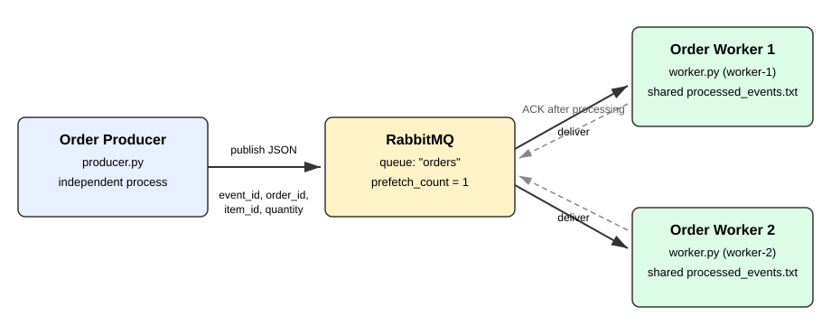
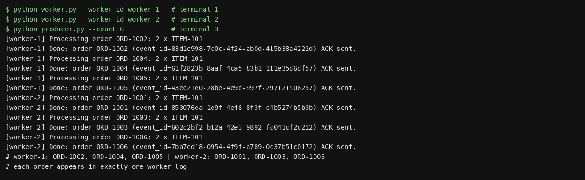
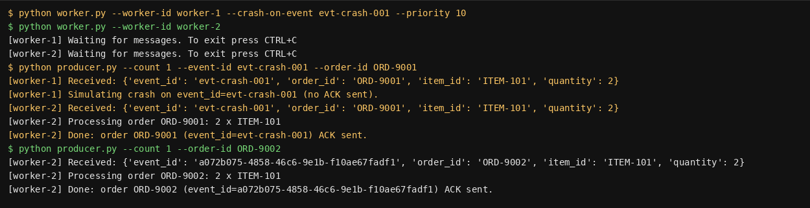
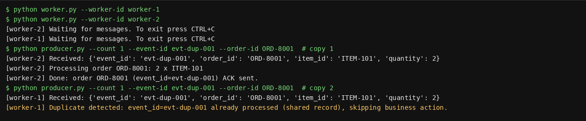

# Order Producer and Worker (RabbitMQ)

Two independent Python processes communicating through a RabbitMQ queue.

## Architecture



The producer publishes JSON order messages. Each worker is a separate
process on the same queue, so they are competing consumers: RabbitMQ
delivers each message to only one worker (`prefetch_count=1`).
A worker sends an ACK only after processing finishes.

## Running

Start RabbitMQ (local install, or Docker):

```bash
rabbitmq-server -detached
# or: docker run -d -p 5672:5672 rabbitmq:3
```

Install dependencies and run the workers in separate terminals.
For a fresh demo run, first delete the shared processed record so
earlier event_ids are not reported as duplicates:

```bash
pip install -r requirements.txt
rm -f processed_events.txt processed_events.lock

python worker.py --worker-id worker-1
python worker.py --worker-id worker-2
```

Publish orders from another terminal:

```bash
python producer.py --count 6
```

Each message contains `event_id`, `order_id`, `item_id`, `quantity`:

```json
{"event_id": "37858e99-...", "order_id": "ORD-1001",
 "item_id": "ITEM-101", "quantity": 2}
```

## Successful message processing

```
[worker-1] Received: {'event_id': '...', 'order_id': 'ORD-1002',
                      'item_id': 'ITEM-101', 'quantity': 2}
[worker-1] Processing order ORD-1002: 2 x ITEM-101
[worker-1] Done: order ORD-1002 (event_id=...) ACK sent.
```

## Evidence: two competing consumers

6 orders published; worker-1 handled ORD-1002, ORD-1004, ORD-1005 and
worker-2 handled ORD-1001, ORD-1003, ORD-1006. No order appears in both
logs, and the queue was empty afterwards. The screenshot below is
plain terminal output from that run:

```
$ python worker.py --worker-id worker-1  # terminal 1
$ python worker.py --worker-id worker-2  # terminal 2
$ python producer.py --count 6           # terminal 3
[worker-1] Processing order ORD-1002: 2 x ITEM-101
[worker-1] Done: order ORD-1002 (event_id=83d1e998-7c0c-4f24-ab0d-415b38a4222d) ACK sent.
[worker-1] Processing order ORD-1004: 2 x ITEM-101
[worker-1] Done: order ORD-1004 (event_id=61f2823b-8aaf-4ca5-83b1-111e35d6df57) ACK sent.
[worker-1] Processing order ORD-1005: 2 x ITEM-101
[worker-1] Done: order ORD-1005 (event_id=43ec21e0-28be-4e9d-997f-297121506257) ACK sent.
[worker-2] Processing order ORD-1001: 2 x ITEM-101
[worker-2] Done: order ORD-1001 (event_id=853076ea-1e9f-4e46-8f3f-c4b5274b5b3b) ACK sent.
[worker-2] Processing order ORD-1003: 2 x ITEM-101
[worker-2] Done: order ORD-1003 (event_id=602c2bf2-b12a-42e3-9892-fc041cf2c212) ACK sent.
[worker-2] Processing order ORD-1006: 2 x ITEM-101
[worker-2] Done: order ORD-1006 (event_id=7ba7ed18-0954-4f9f-a789-0c37b51c0172) ACK sent.
```



## Evidence: failure and redelivery

Worker-1 was started with `--crash-on-event evt-crash-001`, so it
received ORD-9001 and exited without sending an ACK. RabbitMQ
redelivered the same message to worker-2, which processed and ACKed
it. A later order (ORD-9002) was then processed normally, so the
system remained running. The screenshot below is plain terminal
output from that run, in the order events happened. Worker-1's
crash line is its last line: it exited with code 1 without
ACKing, and worker-2 then received, processed, and ACKed the
same message.

```
$ python worker.py --worker-id worker-1 --crash-on-event evt-crash-001 --priority 10
$ python worker.py --worker-id worker-2
[worker-1] Waiting for messages. To exit press CTRL+C
[worker-2] Waiting for messages. To exit press CTRL+C
$ python producer.py --count 1 --event-id evt-crash-001 --order-id ORD-9001
[worker-1] Received: {'event_id': 'evt-crash-001', 'order_id': 'ORD-9001', 'item_id': 'ITEM-101', 'quantity': 2}
[worker-1] Simulating crash on event_id=evt-crash-001 (no ACK sent).
[worker-2] Received: {'event_id': 'evt-crash-001', 'order_id': 'ORD-9001', 'item_id': 'ITEM-101', 'quantity': 2}
[worker-2] Processing order ORD-9001: 2 x ITEM-101
[worker-2] Done: order ORD-9001 (event_id=evt-crash-001) ACK sent.
$ python producer.py --count 1 --order-id ORD-9002
[worker-2] Received: {'event_id': 'a072b075-4858-46c6-9e1b-f10ae67fadf1', 'order_id': 'ORD-9002', 'item_id': 'ITEM-101', 'quantity': 2}
[worker-2] Processing order ORD-9002: 2 x ITEM-101
[worker-2] Done: order ORD-9002 (event_id=a072b075-4858-46c6-9e1b-f10ae67fadf1) ACK sent.
```



Reproduce it (both workers running; `--priority 10` makes RabbitMQ
deliver the first message to the crashing worker):

```bash
rm -f processed_events.txt processed_events.lock
python worker.py --worker-id worker-1 --crash-on-event evt-crash-001 --priority 10
python worker.py --worker-id worker-2
python producer.py --count 1 --event-id evt-crash-001 --order-id ORD-9001
python producer.py --count 1 --order-id ORD-9002
```

## Evidence: duplicate handling

Processed `event_id` values are kept in a shared record,
`processed_events.txt`, which both workers read on every message
under a file lock. The screenshot below is plain terminal output
from that run, in the order events happened: the same event is
published twice, as two separate runs, so copy 1 and copy 2 are
separate lines. Worker-2 processed copy 1, and worker-1 received
copy 2 and reported the duplicate:

```
$ python worker.py --worker-id worker-1
$ python worker.py --worker-id worker-2
[worker-2] Waiting for messages. To exit press CTRL+C
[worker-1] Waiting for messages. To exit press CTRL+C
$ python producer.py --count 1 --event-id evt-dup-001 --order-id ORD-8001  # copy 1
[worker-2] Received: {'event_id': 'evt-dup-001', 'order_id': 'ORD-8001', 'item_id': 'ITEM-101', 'quantity': 2}
[worker-2] Processing order ORD-8001: 2 x ITEM-101
[worker-2] Done: order ORD-8001 (event_id=evt-dup-001) ACK sent.
$ python producer.py --count 1 --event-id evt-dup-001 --order-id ORD-8001  # copy 2
[worker-1] Received: {'event_id': 'evt-dup-001', 'order_id': 'ORD-8001', 'item_id': 'ITEM-101', 'quantity': 2}
[worker-1] Duplicate detected: event_id=evt-dup-001 already processed
           (shared record), skipping business action.
```

The duplicate is still ACKed, so it is removed from the queue
without being processed again.



Reproduce it (two separate publishes, not one `--count 2` run):

```bash
rm -f processed_events.txt processed_events.lock
python worker.py --worker-id worker-1
python worker.py --worker-id worker-2
python producer.py --count 1 --event-id evt-dup-001 --order-id ORD-8001
python producer.py --count 1 --event-id evt-dup-001 --order-id ORD-8001
```

## Reflection

A message can be delivered more than once because RabbitMQ only
removes a message when the consumer ACKs it, so if a worker crashes
or its connection drops before the ACK, the broker must redeliver
the message to keep it from being lost. That at-least-once delivery
means the same order can legitimately arrive twice, even though
nothing went wrong with the queue itself. Idempotent handling
solves this by keying the business action on event_id. The first
delivery is processed and recorded in a record shared by all
workers, and any repeat is recognised and skipped. The result is that redelivery keeps the system
reliable without causing the order to be processed twice.
